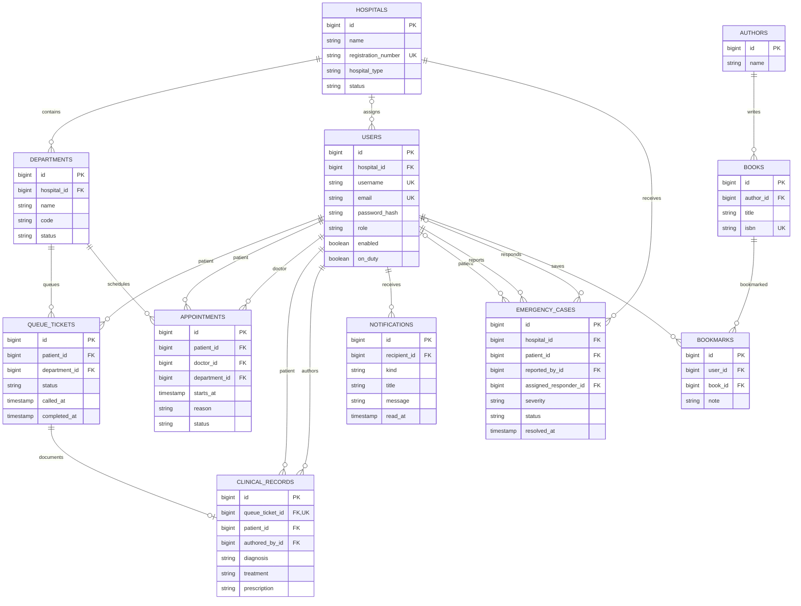

# MediQueue database ER diagram

The diagram reflects the PostgreSQL schema created by Flyway migrations V1 to V11. MediQueue models patients, doctors, staff, responders, and administrators as rows in `users`; the `role` column distinguishes account types. Queue tickets are the visit/history records returned by the API. There is no separate `patients`, `visits`, or `roles` table.

`AUTHORS`, `BOOKS`, and `BOOKMARKS` are retained from the repository's original library starter schema. The MediQueue API does not currently use them.
